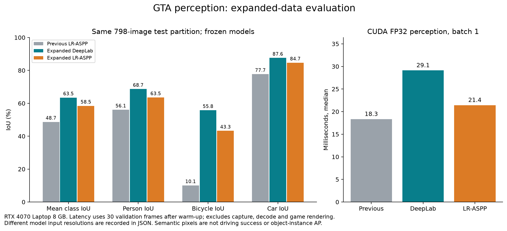

# GTA Assist Lab

Scene perception and driving-assistance experiments in GTA V. The project learns 19 semantic scene classes, tracks nearby actors and records bounded brake decisions in offline replays.

**Research preview.** Live game input is disabled. The brake diagnostic still mistakes the visible ego hood for an external vehicle, and bicycle recognition is weak in the synthetic crossing sequence. This release is for inspecting and reproducing the experiment.


The examples above were selected with a fixed seed using ground-truth class presence. Grey ground-truth regions are ignored by the dataset; the model's predictions there are not verified. Image source: Richter, Vineet, Roth & Koltun, *Playing for Data*, ECCV 2016.

## Measured results

Three frozen models were evaluated on the same 798-image test subset. These are pixel-overlap scores; each model uses its recorded input resolution. Candidate selection used validation data before opening this test.

| Model | Mean IoU | Person IoU | Bicycle IoU | Car IoU | CUDA FP32 p50 |
|---|---:|---:|---:|---:|---:|
| Previous LR-ASPP | 48.7% | 56.1% | 10.1% | 77.7% | 18.3 ms |
| Expanded DeepLab | **63.5%** | **68.7%** | **55.8%** | **87.6%** | 29.1 ms |
| Expanded LR-ASPP | 58.5% | 63.5% | 43.3% | 84.7% | 21.4 ms |



Latency includes preprocessing, transfers and connected components on an RTX 4070 Laptop GPU, using 30 validation frames after warm-up. Capture, decoding and GTA rendering are excluded. The earlier and small models use 768×432 inputs; DeepLab uses 960×544. It is not a GTA FPS measurement.

## Run a recorded video

Python 3.11+; create and activate a virtual environment first. Choose the appropriate PyTorch build for your hardware from the [official installer](https://pytorch.org/get-started/locally/). The measured Windows/CUDA environment used:

```sh
python -m pip install -r requirements.txt
python -m pip install torch==2.14.1 torchvision==0.29.1 --index-url https://download.pytorch.org/whl/cu130
python -m pip install -r training/requirements.txt
python Autonomous-Driving-App-GTA5/assist_lab.py --model gta-semantic-deeplab-expanded.pt --source gameplay.mp4 --no-preview --trace observations.jsonl
```

The trained weights are separate [release assets](https://github.com/temurcanbulut/Autonomous-Driving-App-GTA5/releases/tag/research-2026-10-15). Verify their SHA256 hashes against [models.json](artifacts/models.json). Runtime does not download weights implicitly. `--device cpu` runs without CUDA; `--amp` is an optional CUDA mode. The CLI never presses game keys.

## Training and evaluation

The expanded pool contains 5,999 training images, 795 representative validation images, 798 representative test images and separate 227/283-image rare-class challenges. Training includes 246 bicycle-containing frames. The teacher completed 1+20+8 epochs; the smaller student completed ten additional epochs with teacher distillation. The dataset is [Playing for Data](https://download.visinf.tu-darmstadt.de/data/from_games/), for research/educational use. Raw dataset images are not included in the repository.

- [Model card and reproduction details](docs/MODEL_CARD.md): acquisition, splits, exact training protocol and limitations.
- [Experiments](experiments/README.md): frozen configurations, logs, confusion matrices, corruptions, timing and acceptance checks.
- [Training curve](docs/images/training-curve.png): validation-based checkpoint selection.

## Brake diagnostics

The controller uses fresh speed/gear/driver-status data, approximate calibrated camera geometry and expiring dry-run S leases. The tracker supports time-window lateral motion at high frame rates. No OS input adapter or independent real-input watchdog is included.

In the synthetic validation-only diagnostic, the inserted bicycle matched in 5/40 frames. The sequence with no inserted actor also requested a brake on its first frame because of the ego hood. [The failure frame](docs/images/dry-brake-failure.png), [trace](experiments/composite-diagnostic-class-boxes/no_inserted_actor.jsonl) and [all sequence results](experiments/composite-diagnostic-class-boxes/summary.json) are retained. These artificial sequences are not GTA gameplay or a collision-avoidance benchmark.

[Live-assistance criteria remain unmet](experiments/final-acceptance.json). Camera/ego-mask validation and end-to-end GTA scenarios are still required. The original YOLOv3 entry point remains available under `Autonomous-Driving-App-GTA5/autonomous-driving-app-gta5.py`.

## Development

```sh
python -m pip install -r requirements-dev.txt
python -m ruff check .
python -m unittest discover -s tests -v
```

The recorded local run passed 57 tests. Optional training-math tests require PyTorch and the training dependencies. CI includes Windows/Linux runtime checks and a CPU training-math job.
