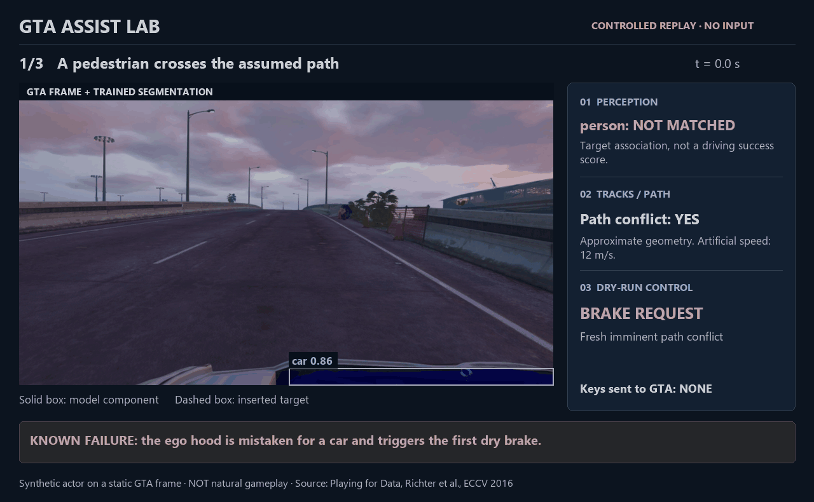
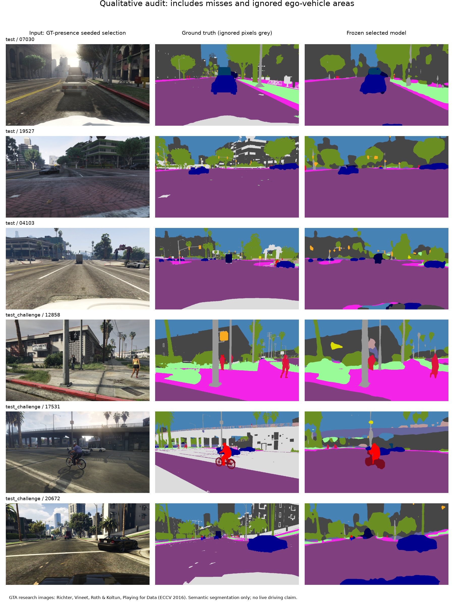

<p align="center">
  <a href="https://github.com/temurcanbulut/Autonomous-Driving-App-GTA5/actions/workflows/ci.yml"></a>
  
  <a href="https://github.com/temurcanbulut/Autonomous-Driving-App-GTA5/releases/tag/research-2026-10-15"></a>
</p>
<h1 align="center">GTA Assist Lab</h1>
<p align="center">Explore scene perception and driving-assistance decisions in GTA V.<br>Trained models, replay tools and inspectable experiment records.</p>
<p align="center"><a href="README.tr.md">Türkçe</a> · <a href="#try-it-without-a-gpu">Try the replay desk</a> · <a href="docs/MODEL_CARD.md">Model card</a> · <a href="docs/ROADMAP.md">Roadmap</a></p>



**Watch the decision pipeline:** model output → tracked objects → estimated path conflict → dry-run brake request. These are composited validation actors on a static GTA scene, with actual model outputs; no game keys are sent. The hood false alarm and bicycle misses remain visible. [Source records and interpretation](docs/DEMONSTRATION.md).

## What you can explore

- **19 scene classes.** Roads, sidewalks, signals, pedestrians, riders, bicycles and vehicles from trained semantic segmentation models.
- **Two trained checkpoints.** A DeepLab teacher and a smaller LR-ASPP student, with published sizes and SHA256 hashes.
- **Replay desk.** Open recorded JSONL in a portable HTML viewer: frame slider, actor boxes, latency timeline, next brake request and source hash. No GPU or server needed to inspect it.
- **Bounded live capture.** A replaceable latest-frame slot avoids a queue of stale screenshots. Screen mode is observation-only.
- **Reproducible evaluation.** Frozen splits, configurations, logs, confusion matrices, corruptions and timings, including unsuccessful cases.

**Research preview:** this is a perception and offline assistance lab. Live game input is disabled. The current diagnostic still mistakes the ego hood for an external car and matches the synthetic bicycle in only 5/40 frames. Those unresolved failures prevent an end-to-end autonomous-driving claim.

## Try it without a GPU

Download or clone the repository and open **[docs/replay-demo.html](docs/replay-demo.html)** as a local file in your browser. GitHub displays the HTML source; use the raw-file download or the [source archive](https://github.com/temurcanbulut/Autonomous-Driving-App-GTA5/archive/refs/heads/main.zip). The viewer is self-contained and makes no network requests.

1. Choose a sequence: pedestrian, bicycle, vehicle cut-in, sidewalk or no inserted actor.
2. Move the frame slider to inspect recorded normalized boxes and controller state.
3. Jump to the next dry-run brake request, then inspect its reason. The first-frame ego-hood failure remains visible.
4. Expand **Source record & interpretation** to see the input SHA256 and diagnostic match count.

To make a viewer from your own trace, only Python's standard library is needed:

```sh
python tools/build_replay_report.py observations.jsonl --output replay.html
```

Use up to eight traces, each at most 16 MiB/50,000 frames. The tool validates timing, geometry and numeric fields; it refuses to overwrite an existing output. Add `--context "..."` to describe how the recording was made. Hashes identify source bytes; they do not authenticate a recording. [Replay format and commands](docs/REPLAY.md).

## Run the trained model

Python 3.11+ in an activated virtual environment. Install the runtime, then choose a PyTorch build from the [official installer](https://pytorch.org/get-started/locally/). The measured Windows/CUDA setup used:

```sh
python -m pip install -r requirements.txt
python -m pip install torch==2.14.1 torchvision==0.29.1 --index-url https://download.pytorch.org/whl/cu130
python -m pip install -r training/requirements.txt
python Autonomous-Driving-App-GTA5/assist_lab.py --model gta-semantic-deeplab-expanded.pt --source gameplay.mp4 --no-preview --trace observations.jsonl
python tools/build_replay_report.py observations.jsonl --output replay.html
```

Get weights from the [model release](https://github.com/temurcanbulut/Autonomous-Driving-App-GTA5/releases/tag/research-2026-10-15), and verify [artifacts/models.json](artifacts/models.json). Nothing downloads implicitly. `--device cpu` uses CPU; install the CPU PyTorch build for that configuration. The CLI emits observations, not game keys.

## Measured perception results

Three frozen models, the same 798-image test subset. Candidate selection used validation data before opening the test. These are pixel-overlap metrics, not driving success rates.

| Model | Mean IoU | Person IoU | Bicycle IoU | Car IoU | CUDA FP32 p50 |
|---|---:|---:|---:|---:|---:|
| Previous LR-ASPP | 48.7% | 56.1% | 10.1% | 77.7% | 18.3 ms |
| Expanded DeepLab | **63.5%** | **68.7%** | **55.8%** | **87.6%** | 29.1 ms |
| Expanded LR-ASPP | 58.5% | 63.5% | 43.3% | 84.7% | 21.4 ms |



Examples were selected with a fixed seed by ground-truth class presence. Grey ground-truth areas are ignored; predictions there are unverified. Image source: Richter, Vineet, Roth & Koltun, *Playing for Data*, ECCV 2016. The [dataset](https://download.visinf.tu-darmstadt.de/data/from_games/) is for research/educational use; raw dataset images are not bundled.

Latency is measured on an RTX 4070 Laptop GPU: 30 validation frames after warm-up, batch one, preprocessing/transfers/components included. Capture, decode and GTA rendering are excluded. LR-ASPP inputs are 768×432, DeepLab 960×544. This is not a GTA FPS measurement. [Result figure](docs/images/perception-results.png) · [Training curve](docs/images/training-curve.png).

## What remains before live assistance

The expanded pool has 5,999 training images, 795 representative validation images, 798 representative test images and separate 227/283-image rare-class challenges. The teacher completed 1+20+8 epochs; the student completed ten additional distillation epochs. More epochs alone do not validate a controller.

Camera/ego-mask validation, natural temporal gameplay, robust bicycle detection and perception-to-brake scenarios remain unmet. The no-actor sequence's false brake and all other failures are available in the viewer and [experiment records](experiments/README.md). [Acceptance checks](experiments/final-acceptance.json) deliberately remain unsuccessful.

## Development

```sh
python -m pip install -r requirements-dev.txt
python -m ruff check .
python -m unittest discover -s tests -v
```

The current local run passes 61 tests with training dependencies available. CI covers Windows/Linux runtime checks and a separate CPU training-math job. [Contributing](CONTRIBUTING.md) · [Security and checkpoint trust](SECURITY.md) · [Changelog](CHANGELOG.md).
