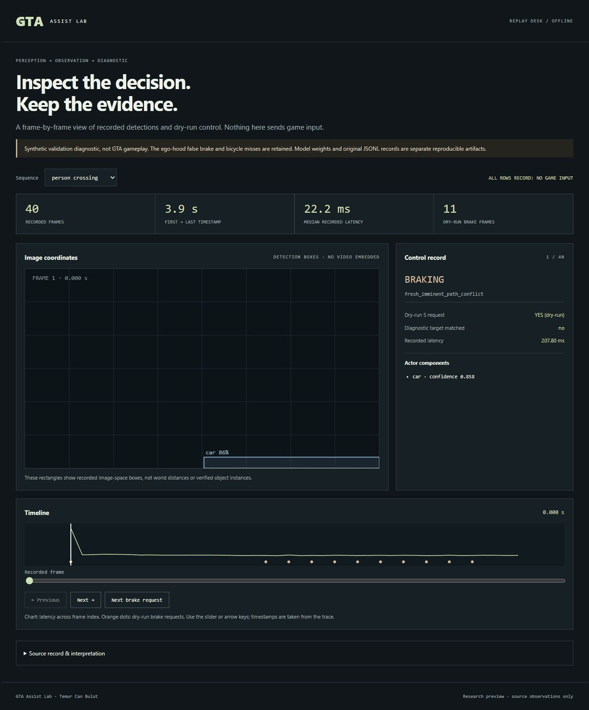

<h1 align="center">GTA Assist Lab</h1>
<p align="center">GTA V sahnelerini algıla. Kayıtları incele. Sürüş desteği kararlarını görünür kıl.</p>
<p align="center"><a href="README.md">English</a> · <a href="docs/MODEL_CARD.md">Model kartı</a></p>



Bu GIF, paketlenmiş yapay doğrulama dizilerinin gerçek JSONL kayıtlarını gösterir; doğal GTA oynanışı değildir. Proje; 19 sınıflı sahne algısı, nesne takibi ve çevrimdışı fren deneyleri içerir. Oyun tuşlarına basmaz.

## GPU olmadan dene

Repoyu indirin ve **docs/replay-demo.html** dosyasını tarayıcıda açın. Python, sunucu veya model kurulumu gerekmez. Dosya dış servise bağlanmaz.

1. Yaya, bisiklet, öne giren araç, kaldırımdaki kişi veya ek aktör bulunmayan diziyi seçin.
2. Zaman çizelgesinde kareyi değiştirin; algı kutularını, kayıtlı süreyi ve kontrol durumunu inceleyin.
3. **Next brake request** ile sonraki kuru fren isteğine gidin. Bu bir oyun müdahalesi değildir.
4. Kaynak bölümünden SHA256 ve tanısal eşleşme sayısını okuyun.

Kendi JSONL kaydınız için yalnızca Python standart kütüphanesi yeterlidir:

```sh
python tools/build_replay_report.py observations.jsonl --output replay.html
```

## Modeli çalıştır

Python 3.11+ ve etkin bir sanal ortam kullanın. PyTorch'u donanımınıza uygun resmi CPU/CUDA sürümünden kurun. Test edilen Windows/CUDA komutları [İngilizce kurulum bölümünde](README.md#run-the-trained-model).

Eğitilmiş DeepLab ve LR-ASPP dosyaları [Releases](https://github.com/temurcanbulut/Autonomous-Driving-App-GTA5/releases/tag/research-2026-10-15) altında. İndirmeyi [model manifestindeki](artifacts/models.json) SHA256 ile doğrulayın.

```sh
python Autonomous-Driving-App-GTA5/assist_lab.py --model gta-semantic-deeplab-expanded.pt --source gameplay.mp4 --no-preview --trace observations.jsonl
python tools/build_replay_report.py observations.jsonl --output replay.html
```

## Ölçülen sonuçlar

Aynı 798 görüntülük testte DeepLab: ortalama IoU **%63,5**, kişi IoU **%68,7**, bisiklet IoU **%55,8**, otomobil IoU **%87,6**. RTX 4070 Laptop GPU'da algı hattı medyanı **29,1 ms**; ekran yakalama, video çözme ve GTA çizimi dahil değildir. Bunlar piksel örtüşme ve gecikme ölçümleridir; sürüş başarısı veya kaza önleme oranı değildir.

## Araştırma durumu

**Henüz doğrulanmış yarı otonom sürüş değil.** Mevcut tanısal dizide kaput harici araç sanılıp ilk karede yanlış fren isteği doğuruyor. Yapay bisiklet dizisinde hedef yalnızca 5/40 karede eşleşiyor. Bu hatalar saklanmadı; örnek arayüzden ve deney kayıtlarından incelenebilir.

Gerçek zamansal oynanış testleri, kamera/ego maskesi ve algıdan frene uçtan uca doğrulama gerekiyor. [Yol haritası](docs/ROADMAP.md) · [Deney kayıtları](experiments/README.md) · [Model kartı](docs/MODEL_CARD.md).
